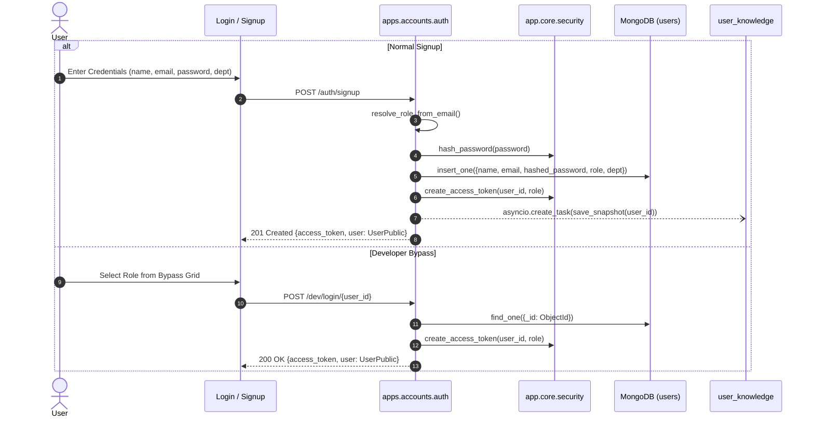
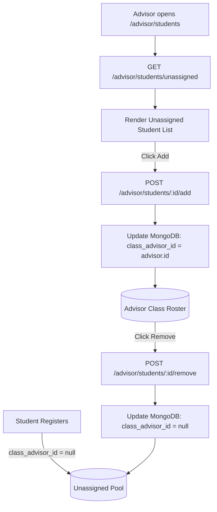
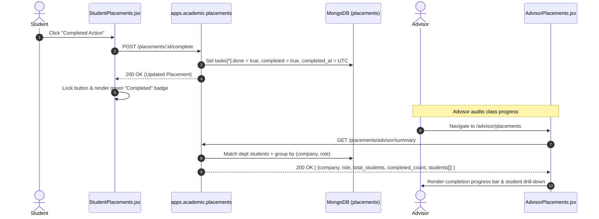
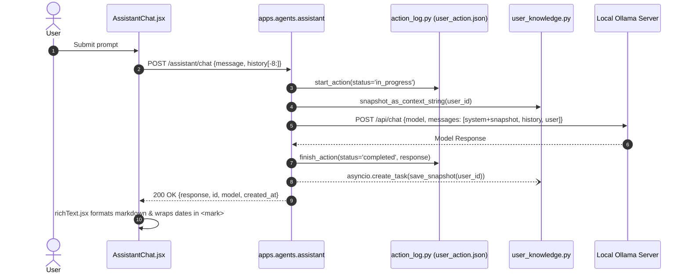
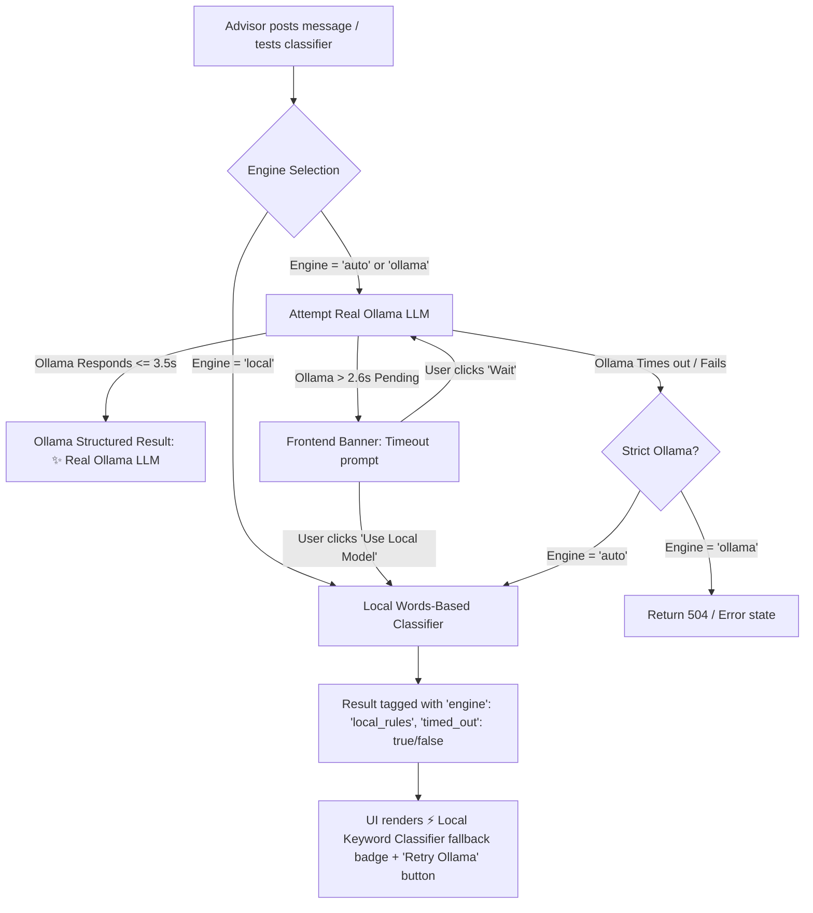

# CampusFlow — Master System Blueprint, Flow Maps, Bug Audit & Performance Analysis

> **Document Type:** Master Architecture Blueprint & Deep Technical Audit  
> **Repository:** `campusflow/`  
> **Technology Stack:** React 18 (Vite) + Custom Glassmorphism CSS System | Django 5.1 + ASGI (Uvicorn) + Django REST Framework + Motor (Async MongoDB) + Local Ollama LLM (`llama3.2`)  
> **Target Audience:** Developers, System Architects, Quality Assurance, Platform Engineers  

---

## Table of Contents
1. [Executive Summary & High-Level Architecture](#1-executive-summary--high-level-architecture)
2. [Complete System Directory & Module Responsibility Matrix](#2-complete-system-directory--module-responsibility-matrix)
3. [Database & Storage Blueprint](#3-database--storage-blueprint)
   - [3.1 MongoDB Database Schema Specification](#31-mongodb-database-schema-specification)
   - [3.2 File-System Data Storage Specification](#32-file-system-data-storage-specification)
   - [3.3 Database Indexing Blueprint](#33-database-indexing-blueprint)
4. [Exhaustive REST API Endpoint Catalog](#4-exhaustive-rest-api-endpoint-catalog)
5. [Frontend Route & Component Blueprint](#5-frontend-route--component-blueprint)
6. [Multi-Tier RBAC Governance Matrix](#6-multi-tier-rbac-governance-matrix)
7. [Agent Brain, Knowledge Grounding & LLM Blueprint](#7-agent-brain-knowledge-grounding--llm-blueprint)
8. [Operational Flow Maps (Mermaid Workflows)](#8-operational-flow-maps-mermaid-workflows)
9. [Exhaustive Bug Audit & Code Defect Catalog](#9-exhaustive-bug-audit--code-defect-catalog)
10. [Performance Lags & Bottleneck Analysis](#10-performance-lags--bottleneck-analysis)
11. [Remediation & Implementation Blueprint](#11-remediation--implementation-blueprint)

---

## 1. Executive Summary & High-Level Architecture

CampusFlow is an academic intelligence, process automation, and communication platform built to coordinate activities across the five core institutional tiers: **Students**, **Class Advisors**, **Heads of Departments (HOD)**, **Principals**, and **System Administrators**.

The application combines a high-performance ASGI Python backend querying an asynchronous MongoDB instance with a local, private Large Language Model (Ollama) providing personalized contextual guidance and automated document classification.

```
+-------------------------------------------------------------------------------------------------------------------+
|                                                 CLIENT TIER (BROWSER)                                             |
|                                        React 18 + Vite + Vanilla CSS Glassmorphism                                |
|                                                                                                                   |
|   +-------------------+  +--------------------+  +---------------+  +---------------------+  +-----------------+  |
|   |   Student Portal  |  |   Advisor Portal   |  |   HOD Portal  |  |   Principal Portal  |  |   Admin Portal  |  |
|   +-------------------+  +--------------------+  +---------------+  +---------------------+  +-----------------+  |
|             \                      \                     |                     /                     /            |
|              +----------------------+--------------------+---------------------+--------------------+             |
|                                     | Token: Bearer JWT (Session / LocalStorage)                                  |
|                                     v                                                                             |
|                           [Centralized API Client (src/api/client.js)]                                            |
|                           [Floating AI Assistant Bubble (AssistantChat.jsx)]                                      |
+-----------------------------------------------------+-------------------------------------------------------------+
                                                      |
                                                      | HTTP / JSON (Port 8000)
                                                      v
+-------------------------------------------------------------------------------------------------------------------+
|                                            APPLICATION TIER (BACKEND)                                             |
|                                Django 5.1 ASGI (Uvicorn Server) + Django REST Framework                           |
|                                                                                                                   |
|   [apps.accounts]      [apps.tasks]         [apps.academic]      [apps.agents]       [apps.communication]         |
|   - auth / login       - task CRUD          - placements         - agent CRUD        - channel messages           |
|   - user directory     - Kanban lifecycle   - skills assessment  - agent network     - direct messages (DM)       |
|   - hierarchy mapping                       - reports/helpdesk   - assistant chat    - read receipts / deletion   |
|                                                                  - message classify                               |
|                                             [apps.platform]                                                       |
|                                             - institutional overview & rollups                                    |
|                                             - live hardware telemetry (psutil / nvidia-smi)                       |
+-----------------------------------------------------+-------------------------------------------------------------+
                           |                          |                                   |
                           | Motor Async Driver       | File I/O (JSON)                   | HTTP (Localhost:11434)
                           v                          v                                   v
             +---------------------------+  +---------------------------+  +-----------------------------+
             |      MONGODB CLUSTER      |  |     FILE-SYSTEM STORE     |  |      OLLAMA LLM SERVER      |
             |---------------------------|  |---------------------------|  |-----------------------------|
             | • users                   |  | • data/user_action.json   |  | • llama3.2 (Active default) |
             | • tasks                   |  | • data/agent_graph.json   |  | • /api/chat (Completion)    |
             | • agents                  |  | • data/agents_config.json |  | • /api/tags (Model list)    |
             | • placements              |  | • data/knowledge/<uid>.json| |                             |
             | • messages                |  +---------------------------+  +-----------------------------+
             | • skills                  |
             | • reports                 |
             | • settings                |
             +---------------------------+
```

---

## 2. Complete System Directory & Module Responsibility Matrix

```
campusflow/
├── backend/                             # Django REST + ASGI + Motor async backend
│   ├── app/                             # Core library & shared services
│   │   ├── api/                         # Serializers & request parsing
│   │   │   ├── requests.py              # Safe request body JSON deserialization
│   │   │   └── serializers.py           # DRF input validation serializers
│   │   ├── core/                        # Authentication & authorization dependencies
│   │   │   ├── deps.py                  # Bearer token decoding & get_current_user
│   │   │   └── security.py              # bcrypt password hashing & JWT generation
│   │   ├── models/                      # Domain & Pydantic models
│   │   │   └── user.py                  # Role enum, UserPublic, UserCreate schemas
│   │   ├── services/                    # Autonomous services & integrations
│   │   │   ├── action_log.py            # Append-only logger for user_action.json
│   │   │   ├── agent_graph.py           # Graph compiler for agent_graph.json
│   │   │   ├── ollama_client.py         # Async httpx client for local Ollama server
│   │   │   └── user_knowledge.py        # Snapshot builder for LLM grounding (<uid>.json)
│   │   ├── config.py                    # Environment settings (JWT, Mongo, Ollama, CORS)
│   │   ├── database.py                  # Motor AsyncIOMotorClient & collection exports
│   │   └── seed.py                      # Database seeding script for all 5 roles
│   ├── apps/                            # Django domain applications
│   │   ├── academic/                    # Placements, skills, and student reports
│   │   │   ├── placements.py            # Recruitment drives & advisor completion rollups
│   │   │   ├── reports.py               # Escalation tickets & resolution tracking
│   │   │   ├── skills.py                # Student skill assessments & progress metrics
│   │   │   └── urls.py                  # Academic route bindings
│   │   ├── accounts/                    # User authentication & hierarchy management
│   │   │   ├── auth.py                  # Signup, login, me endpoints
│   │   │   ├── dev.py                   # Developer passwordless bypass (DEV_MODE=true)
│   │   │   ├── users.py                 # User directory, class allocation, role promotions
│   │   │   └── urls.py                  # Accounts route bindings
│   │   ├── agents/                      # Multi-agent coordination & LLM assistant
│   │   │   ├── agents.py                # Agent CRUD & network edge builder
│   │   │   ├── assistant.py             # Ollama chat, history, and message classification
│   │   │   └── urls.py                  # Agents route bindings
│   │   ├── communication/               # Messaging & broadcasting channels
│   │   │   ├── messages.py              # Group feeds, DMs, read receipts, message pruning
│   │   │   └── urls.py                  # Messaging route bindings
│   │   ├── platform/                    # Infrastructure telemetry & analytics
│   │   │   ├── overview.py              # Department & institution statistical rollups
│   │   │   ├── system.py                # psutil CPU/RAM & nvidia-smi GPU telemetry
│   │   │   └── urls.py                  # Platform route bindings
│   │   └── tasks/                       # Task & daily schedule management
│   │       ├── tasks.py                 # Task CRUD & Kanban status mutation
│   │       └── urls.py                  # Task route bindings
│   ├── data/                            # Persistent JSON file stores
│   │   ├── knowledge/                   # Per-user compiled knowledge snapshots (<id>.json)
│   │   ├── agent_graph.json             # Compiled adjacency matrix & access scopes
│   │   ├── agents_config.json           # Hand-editable static agent definitions
│   │   └── user_action.json             # Resumable assistant interaction journal
│   ├── django_project/                  # Django project root
│   │   ├── asgi.py                      # ASGI application entrypoint for Uvicorn
│   │   ├── settings.py                  # Django settings (CORS, INSTALLED_APPS)
│   │   └── urls.py                      # Root URL dispatcher
│   ├── requirements.txt                 # Pinned Python package dependencies
│   └── manage.py                        # Django administration utility
│
├── frontend/                            # React 18 + Vite frontend
│   ├── src/
│   │   ├── api/                         # Frontend API abstraction layer
│   │   │   ├── agents.js                # Agent list, graph, and status mutations
│   │   │   ├── assistant.js             # Ollama chat, history, and model settings
│   │   │   ├── auth.js                  # Login, signup, me
│   │   │   ├── client.js                # Centralized Axios/fetch client with JWT handling
│   │   │   ├── messages.js              # Group messages and DM thread API
│   │   │   ├── overview.js              # Multi-tier institutional analytics
│   │   │   ├── placements.js            # Drives, task toggles, advisor summaries
│   │   │   ├── reports.js               # Report listing, filing, and status updates
│   │   │   ├── system.js                # Hardware statistics
│   │   │   ├── tasks.js                 # Task retrieval and status updates
│   │   │   └── users.js                 # Directory, class assignment, role promotions
│   │   ├── components/                  # Reusable UI component library
│   │   │   ├── common/                  # Primitives and common widgets
│   │   │   │   ├── AssistantChat.jsx    # Floating LLM assistant widget
│   │   │   │   ├── DirectMessageThread.jsx # 1-to-1 chat component with attachment support
│   │   │   │   ├── CommonGroupFeed.jsx  # Multi-user broadcast announcement feed
│   │   │   │   ├── ErrorBoundary.jsx    # React top-level recovery boundary
│   │   │   │   ├── Primitives.jsx       # GlassCard, ProgressBar, RoleBadge, StatusDot
│   │   │   │   └── StatRing.jsx         # Circular KPI indicators & StatStrip
│   │   │   └── layout/                  # Page scaffolding
│   │   │       ├── AppShell.jsx         # Master layout (Sidebar + Header + Content)
│   │   │       ├── Header.jsx           # Top action bar with user badge & quick links
│   │   │       └── Sidebar.jsx          # Role-driven navigation menu
│   │   ├── context/
│   │   │   └── AuthContext.jsx          # User session, JWT storage, and role state
│   │   ├── lib/
│   │   │   └── richText.jsx             # Markdown, bold/italic & highlighted date parser
│   │   ├── pages/                       # Screen views by domain
│   │   │   ├── auth/                    # Login (with dev bypass) and Signup
│   │   │   └── dashboards/              # 24 role-specific dashboard views
│   │   ├── App.jsx                      # Router declarations & role-based route guard
│   │   ├── index.css                    # Design tokens & glassmorphism stylesheets
│   │   └── main.jsx                     # Vite mount point with ErrorBoundary wrapping
│   ├── package.json                     # Node.js dependencies
│   └── vite.config.js                   # Vite dev server configuration
```

---

## 3. Database & Storage Blueprint

CampusFlow uses a hybrid storage model: MongoDB handles durable state with multi-document queries, while the local filesystem acts as an inspectable, resilient cache for multi-agent graphs, user snapshots, and resumable LLM chat trails.

### 3.1 MongoDB Database Schema Specification

#### Collection 1: `users`
Stores user identities, hashed credentials, academic credentials, and institutional mapping.
```json
{
  "_id": "ObjectId",
  "name": "String (Required)",
  "email": "String (Required, Unique, Lowercase)",
  "hashed_password": "String (Required, bcrypt hash)",
  "role": "String (Enum: 'admin' | 'principal' | 'hod' | 'advisor' | 'student')",
  "dept": "String (Optional, e.g. 'AI & DS', 'CSE', 'ECE', 'All')",
  "class_advisor_id": "String (Optional, ObjectId of mapped Class Advisor; student only)",
  "roll_id": "String (Optional, Student registration number)",
  "mobile": "String (Optional)",
  "dob": "String (Optional, ISO Date)",
  "year": "String (Optional, e.g. 'Year III')",
  "college": "String (Optional)",
  "cgpa": "Double (Optional, e.g. 8.74)",
  "attendance": "Double (Optional, e.g. 88.5)",
  "fairness": "Double (Optional, default 0.2)",
  "semesters": [
    {
      "sem": "String (e.g. 'Sem 1')",
      "gpa": "Double (e.g. 8.5)"
    }
  ],
  "resume_uploaded": "Boolean (default: false)",
  "telegram_linked": "Boolean (default: false)",
  "placement_eligible": "Boolean (default: true)",
  "created_at": "ISODate (default: now)"
}
```

#### Collection 2: `tasks`
Stores personalized student tasks assigned by agents, advisors, or created manually.
```json
{
  "_id": "ObjectId",
  "owner_id": "String (Required, ObjectId of student)",
  "title": "String (Required, task description)",
  "due": "String (Required, formatted date or relative time)",
  "agent": "String (Optional, e.g. 'Academic Assist Agent')",
  "status": "String (Required, Enum: 'pending' | 'in_progress' | 'done')",
  "created_at": "ISODate"
}
```

#### Collection 3: `agents`
Stores autonomous and virtual agent nodes assigned to institutional entities.
```json
{
  "_id": "ObjectId",
  "name": "String (Required, e.g. 'Class Assist Agent')",
  "role": "String (Required, Enum: 'system' | 'hod' | 'advisor' | 'student')",
  "status": "String (Required, Enum: 'running' | 'idle')",
  "accuracy": "Double (default: 95.0)",
  "hallucination": "Double (default: 1.0)",
  "owner_id": "String (Optional, ObjectId of owning user; null for system)",
  "owner_name": "String (Optional, Display name of owner)",
  "deadline": "String (Optional)",
  "created_at": "ISODate"
}
```

#### Collection 4: `placements`
Stores recruitment drives and student application task progression.
```json
{
  "_id": "ObjectId",
  "owner_id": "String (Required, ObjectId of student)",
  "company": "String (Required, e.g. 'Google', 'Microsoft')",
  "role": "String (Required, e.g. 'Software Development Engineer')",
  "package": "String (Optional, e.g. '24 LPA')",
  "deadline": "String (Required, e.g. '15 Nov 2026')",
  "status": "String (Required, Enum: 'action_needed' | 'submitted' | 'interview')",
  "tasks": [
    {
      "title": "String (e.g. 'Aptitude Test Registration')",
      "done": "Boolean (default: false)"
    }
  ],
  "completed": "Boolean (default: false, verified action)",
  "completed_at": "String (Optional, ISO Date)",
  "created_at": "ISODate"
}
```

#### Collection 5: `messages`
Stores all communications across broadcast channels and direct user-to-user threads.
```json
{
  "_id": "ObjectId",
  "group": "String (Required, e.g. 'class-<id>', 'hod-advisor-<dept>', 'principal-hod', 'dm-<id1>-<id2>')",
  "text": "String (Required, message body)",
  "link": "String (Optional, embedded link)",
  "attachment": {
    "type": "String (e.g. 'image/png')",
    "name": "String",
    "data": "String (Base64 encoded string)"
  },
  "workflow": {
    "category": "String (Enum: 'placement' | 'event' | 'academic' | 'attendance' | 'document' | 'general')",
    "action_type": "String (Enum: 'form_entry' | 'file_upload' | 'excel_upload' | 'acknowledge' | 'none')",
    "title": "String",
    "summary": "String",
    "due_at": "String (Optional, ISO Date)"
  },
  "from_user_id": "String (Required, ObjectId of sender)",
  "from_name": "String (Required, sender display name)",
  "created_at": "ISODate (Required)",
  "read_by": ["String (Array of user ObjectIds who opened the message)"],
  "read_count": "Integer (default: 0)",
  "deleted_for": ["String (Array of user ObjectIds who deleted locally)"],
  "deleted_for_everyone": "Boolean (default: false)"
}
```

#### Collection 6: `skills`
Stores student technical capabilities and continuous assessment vectors.
```json
{
  "_id": "ObjectId",
  "owner_id": "String (Required, ObjectId of student)",
  "skill": "String (Required, e.g. 'Data Structures & Algorithms')",
  "level": "Double (Required, percentage 0.0 - 100.0)",
  "topics": [
    {
      "name": "String (e.g. 'Graph Theory')",
      "score": "Double (e.g. 85.0)"
    }
  ],
  "trend": ["Double (7-element array tracking daily assessment score)"]
}
```

#### Collection 7: `reports`
Stores institutional helpdesk tickets, disputes, and escalation reports.
```json
{
  "_id": "ObjectId",
  "subject": "String (Required, summary)",
  "body": "String (Optional, detailed description)",
  "from_user_id": "String (Required, ObjectId of reporter)",
  "from_name": "String (Required, reporter name)",
  "from_dept": "String (Optional, reporter department)",
  "assigned_to": "String (Optional, ObjectId of assignee)",
  "status": "String (Required, Enum: 'open' | 'investigating' | 'resolved')",
  "created_at": "ISODate (Required)"
}
```

#### Collection 8: `settings`
Key-value document store for institution-wide application configurations.
```json
{
  "_id": "assistant",
  "model": "String (Active Ollama model name, e.g. 'llama3.2')",
  "updated_by": "String (ObjectId of Admin who changed it)",
  "updated_at": "String (ISO Date)"
}
```

---

### 3.2 File-System Data Storage Specification

CampusFlow persists four JSON data stores under `backend/data/`:

#### File 1: `backend/data/user_action.json`
- **Purpose:** Append-only transaction journal for all user interactions with the Ollama AI Assistant. Guarantees that chat sessions are resumable across device reboots and page refreshes.
- **Size Capping:** Fixed at 2,000 institution-wide records (FIFO prune).
- **Structure:**
```json
[
  {
    "id": "uuid-v4-hex",
    "user_id": "6a8c2ce4a963fc2909bfdb5d",
    "user_name": "Student Demo",
    "role": "student",
    "step": "chat_query",
    "message": "What tasks are due this week?",
    "response": "You have **2 pending tasks**:\n- **DSA Assignment** due **Tomorrow at 5:00 PM**\n- **OS Lab Report** due **18 Oct 2026**",
    "model": "llama3.2",
    "status": "completed",
    "created_at": "2026-10-11T12:00:00+00:00",
    "updated_at": "2026-10-11T12:00:03+00:00"
  }
]
```

#### File 2: `backend/data/agent_graph.json`
- **Purpose:** The compiled network topology detailing every active agent, undirected adjacency edges, and per-user access scopes.
- **Structure:**
```json
{
  "generated_at": "2026-10-11T16:30:00+00:00",
  "agents": {
    "6a8c2...": {
      "name": "Class Assist Agent",
      "role": "advisor",
      "status": "running",
      "accuracy": 96.5,
      "hallucination": 0.5,
      "owner_id": "advisor_id_here",
      "owner_name": "Prof. Alan Turing",
      "deadline": null
    }
  },
  "connections": {
    "agent_id_1": ["agent_id_2", "agent_id_3"]
  },
  "role_graph": {
    "system": ["advisor", "hod"],
    "advisor": ["hod", "student", "system"],
    "hod": ["advisor", "system"],
    "student": ["advisor"]
  },
  "access_scope": {
    "user_id_1": ["agent_id_1", "agent_id_2"]
  }
}
```

#### File 3: `backend/data/agents_config.json`
- **Purpose:** Hand-editable configuration file enabling administrators to inject static or mock agents without modifying MongoDB.
- **Structure:**
```json
{
  "_comment": "Add hand-managed agents and custom edges here.",
  "agents": {
    "static-agent-1": {
      "name": "System Health Monitor",
      "role": "system",
      "status": "running",
      "accuracy": 99.0,
      "hallucination": 0.1,
      "owner_id": null,
      "owner_name": "CampusFlow Core"
    }
  },
  "connections": [
    ["static-agent-1", "static-agent-2"]
  ]
}
```

#### File 4: `backend/data/knowledge/<user_id>.json`
- **Purpose:** Consolidated context snapshot of a specific user. Built asynchronously on signup, login, and assistant interactions. Injected into the Ollama system prompt to ground the LLM with live user data.
- **Structure:**
```json
{
  "meta": { "generated_at": "ISO", "user_id": "...", "role": "student", "name": "..." },
  "profile": { "cgpa": 8.7, "attendance": 92.0, "dept": "AI & DS" },
  "tasks": [{ "title": "Maths Assignment", "due": "Friday", "status": "pending" }],
  "skills": [{ "skill": "Python", "level": 90.0 }],
  "placements": [{ "company": "Google", "role": "SDE", "status": "action_needed" }],
  "recent_messages": {
    "class_group": [],
    "direct_messages": []
  },
  "reports": [],
  "activity_log": [],
  "stats": {
    "tasks_done": 4,
    "tasks_pending": 2,
    "skills_count": 5,
    "avg_skill_level": 82.5
  }
}
```

---

### 3.3 Database Indexing Blueprint

To prevent `COLLSCAN` degradations as collections scale, the following MongoDB indexes must be established:

| Collection | Key | Type | Rationale |
|---|---|---|---|
| `users` | `email` | **Unique Index** | Prevents duplicate account creation; accelerates authentication lookups |
| `users` | `dept` | Secondary Index | Optimizes department queries for HOD and Advisor views |
| `users` | `class_advisor_id` | Secondary Index | Optimizes student roster retrieval for advisors |
| `tasks` | `owner_id` | Secondary Index | Speeds up student Kanban board queries |
| `tasks` | `{ owner_id: 1, status: 1 }` | Compound Index | Optimizes task completion calculations in analytics |
| `agents` | `owner_id` | Secondary Index | Accelerates personal agent lookups |
| `placements` | `owner_id` | Secondary Index | Speeds up student placement drive retrieval |
| `placements` | `company` | Secondary Index | Speeds up recruitment drive groupings |
| `messages` | `group` | Secondary Index | Critical for 3-second group feed polling queries |
| `messages` | `{ group: 1, created_at: -1 }` | Compound Index | Enables index-supported reverse-chronological sorting |
| `skills` | `owner_id` | Secondary Index | Speeds up student skill queries |
| `reports` | `from_dept` | Secondary Index | Scopes escalation tickets by department for HODs |

---

## 4. Exhaustive REST API Endpoint Catalog

All routes require `Authorization: Bearer <token>` unless marked **Public**.

| Domain | Method | URL Path | Role ACL | Request Payload / Params | Response Payload / Status |
|---|---|---|---|---|---|
| **Auth** | `POST` | `/auth/signup` | Public | `{name, email, password, dept?}` | `{access_token, user: UserPublic}` (201) |
| **Auth** | `POST` | `/auth/login` | Public | `{email, password}` | `{access_token, user: UserPublic}` (200) |
| **Auth** | `GET` | `/auth/me` | Authenticated | None | `UserPublic` (200) |
| **Dev** | `GET` | `/dev/users` | DEV_MODE only | None | `[UserPublic, ...]` (200) |
| **Dev** | `POST` | `/dev/login/<user_id>` | DEV_MODE only | None | `{access_token, user: UserPublic}` (200) |
| **Users** | `GET` | `/users/me` | Authenticated | None | `UserPublic` (200) |
| **Users** | `PATCH` | `/users/me` | Authenticated | `{name?, mobile?, dob?, year?, college?}` | `UserPublic` (200) |
| **Users** | `GET` | `/users/directory` | Authenticated | None | `[{id, name, email, role, dept}]` (200) |
| **Users** | `GET` | `/users` | Admin only | None | `[UserPublic, ...]` (200) |
| **Users** | `PATCH` | `/users/<id>/role` | Admin only | `{role, dept?}` | `UserPublic` (200) |
| **Users** | `DELETE`| `/users/<id>` | Admin only | None | `204 No Content` |
| **Users** | `GET` | `/advisor/students` | Staff only | None | `[UserPublic, ...]` (200) |
| **Users** | `GET` | `/advisor/students/unassigned`| Staff only | None | `[UserPublic, ...]` (200) |
| **Users** | `POST` | `/advisor/students/<id>/add` | Advisor only | None | `UserPublic` (200) |
| **Users** | `POST` | `/advisor/students/<id>/remove`| Advisor only | None | `UserPublic` (200) |
| **Users** | `PATCH`| `/advisor/students/<id>/academic`| Staff only | `{cgpa?, attendance?}` | `UserPublic` (200) |
| **Users** | `GET` | `/users/hierarchy/candidates` | Staff only | `?target_role=advisor|hod|student` | `[UserPublic, ...]` (200) |
| **Users** | `POST` | `/users/hierarchy/<action>` | Staff only | `{user_id, dept?}` | `UserPublic` (200) |
| **Tasks** | `GET` | `/tasks` | Authenticated | None | `[{id, owner_id, title, due, status, agent}]` (200) |
| **Tasks** | `POST` | `/tasks` | Authenticated | `{title, due, agent?, status?}` | `TaskOut` (201) |
| **Tasks** | `PATCH`| `/tasks/<id>` | Authenticated | `{title?, due?, status?}` | `TaskOut` (200) |
| **Agents** | `GET` | `/agents` | Authenticated | None | `[AgentOut, ...]` (200) |
| **Agents** | `POST` | `/agents` | Admin only | `{name, role, status?, accuracy?, hallucination?}` | `AgentOut` (201) |
| **Agents** | `PATCH`| `/agents/<id>/status` | Admin only | Query/Body: `{status_value}` | `AgentOut` (200) |
| **Agents** | `GET` | `/agents/network` | Authenticated | None | `{agents: [...], edges: [[id1, id2], ...]}` (200) |
| **Agents** | `GET` | `/agents/graph` | Authenticated | None | `{generated_at, agents: {}, connections: {}, role_graph: {}}` (200) |
| **Agents** | `GET` | `/agents/graph/full` | Admin only | None | Full unscoped graph dict (200) |
| **Assistant**| `POST` | `/assistant/chat` | Authenticated | `{message, history: [{role, content}]}` | `{id, response, status, model, created_at}` (200) |
| **Assistant**| `GET` | `/assistant/history` | Authenticated | `?limit=20` | `[ActionLogRecord, ...]` (200) |
| **Assistant**| `GET` | `/assistant/models` | Admin only | None | `{active: '...', models: [{name, size, ...}]}` (200) |
| **Assistant**| `POST` | `/assistant/model` | Admin only | `{model: 'model_name'}` | `{active: 'model_name'}` (200) |
| **Assistant**| `POST` | `/assistant/classify-message`| Staff only | `{message: '...'}` | `{classification: {...}, model: '...'}` (200) |
| **Messages** | `GET` | `/messages` | Authenticated | `?group=<group_id>` | `[MessageOut, ...]` (200) |
| **Messages** | `POST` | `/messages` | Authenticated | `{group, text, link?, attachment?, workflow?}` | `MessageOut` (201) |
| **Messages** | `GET` | `/messages/dm/threads` | Authenticated | None | `[{group, other_user_id, other_user_name, last_text, ...}]` (200) |
| **Messages** | `PATCH`| `/messages/read/<id>` | Authenticated | None | `MessageOut` (200) |
| **Messages** | `DELETE`| `/messages/<id>` | Authenticated | `?scope=me|everyone` | `{ok: true, scope: '...'}` (200) |
| **Academic** | `GET` | `/placements` | Authenticated | None | `[PlacementOut, ...]` (200) |
| **Academic** | `POST` | `/placements` | Authenticated | `{company, role, deadline, package?, tasks?}` | `PlacementOut` (201) |
| **Academic** | `PATCH`| `/placements/<id>` | Authenticated | `{company?, role?, deadline?, status?}` | `PlacementOut` (200) |
| **Academic** | `DELETE`| `/placements/<id>` | Authenticated | None | `204 No Content` |
| **Academic** | `PATCH`| `/placements/<id>/tasks/<idx>`| Authenticated | `?done=true|false` | `PlacementOut` (200) |
| **Academic** | `POST` | `/placements/<id>/complete` | Authenticated | None | `PlacementOut` (200) |
| **Academic** | `GET` | `/placements/advisor/summary`| Staff only | None | `[{company, role, total_students, completed_count, students: [...]}]` (200) |
| **Academic** | `GET` | `/skills/me` | Authenticated | None | `[SkillOut, ...]` (200) |
| **Academic** | `POST` | `/skills` | Authenticated | `{skill, level, topics?, trend?}` | `SkillOut` (201) |
| **Academic** | `PATCH`| `/skills/<id>` | Authenticated | `{level?, topics?, trend?}` | `SkillOut` (200) |
| **Academic** | `DELETE`| `/skills/<id>` | Authenticated | None | `204 No Content` |
| **Academic** | `GET` | `/reports` | Staff only | None | `[ReportOut, ...]` (200) |
| **Academic** | `POST` | `/reports` | Authenticated | `{subject, body?}` | `ReportOut` (201) |
| **Academic** | `PATCH`| `/reports/<id>` | Staff only | `{status: 'investigating'|'resolved'}` | `ReportOut` (200) |
| **Platform** | `GET` | `/overview/departments` | Staff only | None | `[{dept, students, advisors, agents_running, avg_completion}]` (200) |
| **Platform** | `GET` | `/overview/institution` | Executive | None | `{total_students, total_departments, overall_completion_rate, messages_this_week}` (200) |
| **Platform** | `GET` | `/overview/completion-by-student`| Staff only | None | `[{name, dept, rate}]` (200) |
| **Platform** | `GET` | `/overview/staff-activity` | Staff only | None | `[{name, role, dept, messages_sent, tasks_reviewed, activity}]` (200) |
| **Platform** | `GET` | `/system/stats` | Admin only | None | `{cpu_percent, cpu_cores, memory_used_gb, memory_total_gb, gpu_available, ...}` (200) |

---

## 5. Frontend Route & Component Blueprint

```
App.jsx Routing Architecture
├── Public Routes
│   ├── /login               → <Login /> (with Dev Bypass Modal)
│   ├── /signup              → <Signup />
│   └── *                    → <NotFound />
│
├── Student Tier (Role: 'student')
│   ├── /student             → <StudentDashboard /> (Tasks, Daily Plan, CGPA, Placements Preview, Skills Preview)
│   ├── /student/tasks       → <StudentTasks /> (Kanban board: pending, in_progress, done)
│   ├── /student/placements  → <StudentPlacements /> (Drives list, task completion, checklist)
│   ├── /student/skills      → <StudentSkills /> (Assessments, topic breakdown, 7-day sparklines)
│   ├── /student/group       → <StudentGroup /> (Class channel: class-<advisor_id>)
│   ├── /student/profile     → <StudentProfile /> (Profile view and metadata edit)
│   └── /student/messages    → <MyMessages /> (DM threads & 1-to-1 chat window)
│
├── Advisor Tier (Role: 'advisor')
│   ├── /advisor             → <AdvisorDashboard /> (Class KPI stat strip, at-risk alerts, class announcement feed)
│   ├── /advisor/students    → <AdvisorStudents /> (Class roster, unassigned pool, Add/Remove actions)
│   ├── /advisor/placements  → <AdvisorPlacements /> (Department-wide placement drives & student completion breakdown)
│   ├── /advisor/network     → <NetworkView scopeLabel="Class · CSE-C" /> (Agent network canvas)
│   ├── /advisor/group       → <AdvisorGroup /> (Class broadcast & HOD circle with AI message classification)
│   ├── /advisor/messages    → <MyMessages /> (Direct messages with students/HOD)
│   └── /advisor/notifications → <AccountNotifications /> (Profile settings)
│
├── HOD Tier (Role: 'hod')
│   ├── /hod                 → <HodDashboard /> (Department KPIs, Class Advisor delegations, open reports)
│   ├── /hod/network         → <NetworkView scopeLabel="Department · AI & DS" /> (Departmental agent graph)
│   ├── /hod/group           → <HodAdvisorGroup /> (HOD-Advisor circle & Principal-HOD channel)
│   ├── /hod/messages        → <MyMessages /> (Direct messages)
│   └── /hod/notifications   → <AccountNotifications /> (Profile settings)
│
├── Principal Tier (Role: 'principal')
│   ├── /principal           → <PrincipalDashboard /> (Institution stats, department comparison, staff activity index)
│   ├── /principal/departments → <PrincipalDepartments /> (Departmental cards & avg task completion rates)
│   ├── /principal/group     → <PrincipalHodGroup /> (Institution broadcast to all department heads)
│   ├── /principal/messages  → <MyMessages /> (Direct messages)
│   └── /principal/notifications → <AccountNotifications /> (Profile settings)
│
└── Admin Tier (Role: 'admin')
    ├── /admin               → <AdminDashboard /> (Agent execution telemetry, live accuracy, hallucination tracking)
    ├── /admin/network       → <NetworkView scopeLabel="Institution — full access" /> (Global agent topology)
    ├── /admin/agent-manager → <AgentManagerSettings /> (Live CPU/RAM/GPU telemetry & Ollama model picker)
    ├── /admin/users         → <AdminUsers /> (Complete user directory, role assignment, account deletion)
    ├── /admin/message       → <AdminDirectMessage /> (Direct messaging console across all users)
    ├── /admin/reports       → <AdminReports /> (Escalation helpdesk queue & status resolution)
    └── /admin/notifications → <AccountNotifications /> (Profile settings)
```

---

## 6. Multi-Tier RBAC Governance Matrix

| Resource / Action | Student | Class Advisor | Dept HOD | Principal | Admin |
|---|:---:|:---:|:---:|:---:|:---:|
| **Sign up / Authenticate** | Own Account | Own Account | Own Account | Own Account | Full Access |
| **Manage Profile (`PATCH /users/me`)** | Own Profile | Own Profile | Own Profile | Own Profile | Own Profile |
| **Manage Tasks (`/tasks`)** | Own Tasks | Read Class | Read Dept | Read All | Full Access |
| **Class Roster Mapping** | Read Own | Add / Remove Class | Oversee Dept | Oversee All | Full Access |
| **Role Promotion (`/users/hierarchy`)** | ❌ Forbidden | ❌ Forbidden | Assign Advisor | Assign HOD | Full Delegation |
| **Delete User (`DELETE /users/:id`)** | ❌ Forbidden | ❌ Forbidden | ❌ Forbidden | ❌ Forbidden | ✅ Permitted |
| **Class Channel (`class-<id>`)** | Own Class | Own Class | ❌ Forbidden | ❌ Forbidden | ✅ Full Access |
| **HOD Circle (`hod-advisor-<dept>`)**| ❌ Forbidden | Own Dept | Own Dept | ❌ Forbidden | ✅ Full Access |
| **Executive Channel (`principal-hod`)**| ❌ Forbidden | ❌ Forbidden | ✅ Permitted | ✅ Permitted | ✅ Full Access |
| **Direct Messaging (`/messages/dm`)**| Permitted | Permitted | Permitted | Permitted | Permitted |
| **Message Classification (NLP)** | ❌ Forbidden | ✅ Permitted | ✅ Permitted | ✅ Permitted | ✅ Permitted |
| **Hardware Telemetry (`/system/stats`)**| ❌ Forbidden | ❌ Forbidden | ❌ Forbidden | ❌ Forbidden | ✅ Permitted |
| **Ollama Model Selection** | ❌ Forbidden | ❌ Forbidden | ❌ Forbidden | ❌ Forbidden | ✅ Permitted |
| **Submit Helpdesk Report** | ✅ Permitted | ✅ Permitted | ✅ Permitted | ✅ Permitted | ✅ Permitted |
| **Resolve Escalation Report** | ❌ Forbidden | ❌ Forbidden | Own Dept | ❌ Forbidden | ✅ Permitted |

---

## 7. Agent Brain, Knowledge Grounding & LLM Blueprint

### 7.1 Architecture & Components
The AI subsystem connects each user to a dedicated virtual persona powered by a local Ollama LLM server (`http://localhost:11434`):

```
+-----------------------------------------------------------------------------------------------+
|                                    OLLAMA ASSISTANT SUBSYSTEM                                  |
|                                                                                               |
|  1. Ingestion: POST /assistant/chat {message, history[-8:]}                                   |
|  2. Logging: action_log.start_action() -> backend/data/user_action.json ('in_progress')        |
|  3. Grounding: user_knowledge.snapshot_as_context_string() -> loads backend/data/knowledge/   |
|  4. Dynamic Persona: ROLE_BRIEF injected into System Prompt with Markdown & Formatting rules  |
|  5. Execution: ollama_client.chat(model, messages) -> POST http://localhost:11434/api/chat    |
|  6. Finalize: action_log.finish_action() -> updates record to 'completed' / 'error'           |
|  7. Background Snapshot: asyncio.create_task(user_knowledge.save_snapshot())                  |
|  8. Client Render: richText.jsx parses bold, italics, and wraps dates in <mark> pills         |
+-----------------------------------------------------------------------------------------------+
```

### 7.2 System Prompt & Role Personas
Each role receives a tailored system prompt grounding responses in institutional domain rules:
- **Student Persona:** *"You are the personal assistant agent for [Name], a student using CampusFlow to track tasks, placement drives, skills, attendance and CGPA. Format replies in Markdown. Bold every deadline, date, or time."*
- **Advisor Persona:** *"You are the assistant agent for [Name], a class advisor overseeing one class of students."*
- **HOD Persona:** *"You are the assistant agent for [Name], a Head of Department overseeing advisors and students."*
- **Principal Persona:** *"You are the assistant agent for [Name], the Principal with an institution-wide view."*
- **Admin Persona:** *"You are the assistant agent for [Name], a system administrator managing platform health."*

### 7.3 Message Classification NLP Pipeline
Advisors broadcasting announcements can run automated classification (`POST /assistant/classify-message`). The local model extracts:
- `category`: `placement` | `event` | `academic` | `attendance` | `document` | `general`
- `action_type`: `form_entry` | `file_upload` | `excel_upload` | `acknowledge` | `none`
- `due_at`: Extracted ISO date or `null` (strict instruction: *do not invent deadlines*)

---

## 8. Operational Flow Maps (Mermaid Workflows)

### Flow 1: Authentication & Session Token Lifecycle


### Flow 2: Class Assignment & Student Pool Allocation


### Flow 3: Placement Verification & Multi-Tier Aggregation


### Flow 4: Resumable AI Assistant Interaction


---

## 9. Exhaustive Bug Audit & Code Defect Catalog

### Bug 1: Channel 403 Forbidden Error on Dashboards
- **Severity:** 🔴 **Critical (Breaks Student and Advisor Dashboards)**
- **Locations:**
  - [StudentDashboard.jsx](file:///c:/Users/hpvic/Documents/PRO/campusflow/frontend/src/pages/dashboards/StudentDashboard.jsx#L397)
  - [AdvisorDashboard.jsx](file:///c:/Users/hpvic/Documents/PRO/campusflow/frontend/src/pages/dashboards/AdvisorDashboard.jsx#L12)
  - [messages.py](file:///c:/Users/hpvic/Documents/PRO/campusflow/backend/apps/communication/messages.py#L55-L65)
- **Defect Mechanism:**
  `StudentDashboard` calls `listMessages("CSE-C")` inside a `Promise.all` array. In `backend/apps/communication/messages.py`, `_allowed(group, user)` strictly permits:
  ```python
  if group.startswith(DM_PREFIX): ...
  if group.startswith("class-") or group.startswith("advisor-class-"): ...
  if group.startswith("hod-advisor-"): ...
  if group == "principal-hod": ...
  return False
  ```
  `"CSE-C"` fails all conditions and returns `403 Access denied`.
- **System Impact:**
  `Promise.all` immediately rejects, causing `tasks`, `agents`, `placements`, and `skills` to reset to empty arrays (`[]`), and displaying a red `"Access denied"` error across the student dashboard.
- **Remediation:**
  1. In `messages.py`, permit department cohort group keys:
     ```python
     if group in ("CSE-C", "AIDS-A", "general") or group.startswith("dept-"):
         return True
     ```
  2. In `StudentDashboard.jsx`, derive `groupId = user?.class_advisor_id ? 'class-${user.class_advisor_id}' : null`.
  3. Replace `Promise.all` with `Promise.allSettled` to prevent one failing call from destroying the entire dashboard.

---

### Bug 2: Missing `tasks_done` / `tasks_total` in Advisor Students API
- **Severity:** 🟠 **High (Data Disconnect / Broken Roster UI)**
- **Locations:**
  - [users.py](file:///c:/Users/hpvic/Documents/PRO/campusflow/backend/apps/accounts/users.py#L108-L112)
  - [AdvisorStudents.jsx](file:///c:/Users/hpvic/Documents/PRO/campusflow/frontend/src/pages/dashboards/AdvisorStudents.jsx#L157-L158)
  - [AdvisorDashboard.jsx](file:///c:/Users/hpvic/Documents/PRO/campusflow/frontend/src/pages/dashboards/AdvisorDashboard.jsx#L52)
  - [HodDashboard.jsx](file:///c:/Users/hpvic/Documents/PRO/campusflow/frontend/src/pages/dashboards/HodDashboard.jsx#L169-L172)
- **Defect Mechanism:**
  The frontend expects `s.tasks_done` and `s.tasks_total` for each student. However, `GET /advisor/students` in `backend/apps/accounts/users.py` returns `user_doc_to_public(item)`, which only serializes `UserPublic` fields (omitting task metrics).
- **System Impact:**
  - The UI renders `0 of undefined complete` and `undefined/undefined tasks`.
  - In `AdvisorDashboard.jsx`, the `atRisk` filter (`s.tasks_total > 0 && s.tasks_done < s.tasks_total - 3`) breaks.
- **Remediation:**
  Update `students(request)` in `users.py` to query task counts:
  ```python
  students_out = []
  async for item in users_col.find(query):
      pub = user_doc_to_public(item).model_dump(mode="json")
      sid = str(item["_id"])
      pub["tasks_total"] = await tasks_col.count_documents({"owner_id": sid})
      pub["tasks_done"] = await tasks_col.count_documents({"owner_id": sid, "status": "done"})
      students_out.append(pub)
  return JsonResponse(students_out, safe=False)
  ```

---

### Bug 3: Role String Mismatch in `PrincipalGroup.jsx`
- **Severity:** 🟡 **Medium (Feature Inoperable)**
- **Locations:**
  - [PrincipalGroup.jsx](file:///c:/Users/hpvic/Documents/PRO/campusflow/frontend/src/pages/dashboards/PrincipalGroup.jsx#L26)
  - [user.py](file:///c:/Users/hpvic/Documents/PRO/campusflow/backend/app/models/user.py#L14)
- **Defect Mechanism:**
  `PrincipalGroup.jsx` filters directory users with:
  ```javascript
  setAdvisorList(users.filter((u) => u.role === "class_advisor"))
  ```
  In MongoDB and `Role(str, Enum)`, the role value is `"advisor"`, never `"class_advisor"`.
- **System Impact:**
  The dropdown remains empty. The Principal can never select an advisor to view class groups.
- **Remediation:**
  Change line 26 of `PrincipalGroup.jsx` to:
  ```javascript
  setAdvisorList(users.filter((u) => u.role === "advisor"))
  ```

---

### Bug 4: Placement Drive Messages Blocked by Backend ACL
- **Severity:** 🟡 **Medium (Silently failing background request)**
- **Locations:**
  - [StudentPlacements.jsx](file:///c:/Users/hpvic/Documents/PRO/campusflow/frontend/src/pages/dashboards/StudentPlacements.jsx#L40-L42)
  - [messages.py](file:///c:/Users/hpvic/Documents/PRO/campusflow/backend/apps/communication/messages.py#L55-L65)
- **Defect Mechanism:**
  Expanding a placement drive triggers `listMessages('placement-${drive.id}')`. In `messages.py`, `_allowed()` rejects channels not matching standard prefixes.
- **System Impact:**
  Throws `403 Access denied` on every card expansion.
- **Remediation:**
  Add placement channel support in `messages.py`:
  ```python
  if group.startswith("placement-"):
      return True
  ```

---

### Bug 5: Missing `DELETE` Method on Tasks API
- **Severity:** 🟡 **Medium (Incomplete CRUD API)**
- **Locations:**
  - [tasks.py](file:///c:/Users/hpvic/Documents/PRO/campusflow/backend/apps/tasks/tasks.py#L56-L84)
- **Defect Mechanism:**
  `tasks.py` only implements `GET`, `POST`, and `PATCH`. There is no HTTP `DELETE` route or handler.
- **System Impact:**
  Calling `api.del('/tasks/<id>')` returns `405 Method not allowed`. Obsolete tasks cannot be removed.
- **Remediation:**
  Add a `delete_task` endpoint in `tasks.py`:
  ```python
  async def delete_task(request, task_id):
      if request.method != "DELETE":
          return _error("Method not allowed", 405)
      user = await _user(request)
      res = await tasks_col.delete_one({"_id": ObjectId(task_id), "owner_id": user.id})
      if res.deleted_count == 0:
          return _error("Task not found", 404)
      return JsonResponse({}, status=204)
  ```

---

### Bug 6: MongoDB Indexes Defined but Never Created at Runtime
- **Severity:** 🟠 **High (Reliability & Performance Risk)**
- **Locations:**
  - [database.py](file:///c:/Users/hpvic/Documents/PRO/campusflow/backend/app/database.py#L18-L28)
- **Defect Mechanism:**
  `ensure_indexes()` exists in `database.py` but is never executed during startup.
- **System Impact:**
  - MongoDB operates with zero non-primary indexes.
  - Duplicate email signups are possible under concurrent requests.
  - Every filter executes a full collection scan (`COLLSCAN`).
- **Remediation:**
  Call `await ensure_indexes()` inside an async startup hook or ASGI lifespan.

---

### Bug 7: Orphaned Report Creation API (No Frontend UI)
- **Severity:** 🟡 **Medium (Unusable Feature)**
- **Locations:**
  - [reports.js](file:///c:/Users/hpvic/Documents/PRO/campusflow/frontend/src/api/reports.js#L4)
  - [reports.py](file:///c:/Users/hpvic/Documents/PRO/campusflow/backend/apps/academic/reports.py#L58-L86)
- **Defect Mechanism:**
  `fileReport()` is defined in `reports.js` and `POST /reports` exists in Django, but no button, modal, or form exists in the frontend UI to call it.
- **System Impact:**
  Reports can only be submitted via manual cURL calls.
- **Remediation:**
  Create a `<FileReportModal />` and place trigger buttons in `StudentDashboard` and `AdvisorDashboard`.

---

### Bug 8: Skills Read-Only UI
- **Severity:** ⚪ **Minor (Incomplete UI)**
- **Locations:**
  - [skills.py](file:///c:/Users/hpvic/Documents/PRO/campusflow/backend/apps/academic/skills.py#L60-L125)
  - [StudentSkills.jsx](file:///c:/Users/hpvic/Documents/PRO/campusflow/frontend/src/pages/dashboards/StudentSkills.jsx)
- **Defect Mechanism:**
  The backend implements full CRUD (`POST`, `PATCH`, `DELETE`) for skills, but `StudentSkills.jsx` is strictly read-only (`GET /skills/me`).

---

### Bug 9: Unhandled `InvalidId` in JWT User Lookups
- **Severity:** 🟡 **Medium (Uncaught 500 Server Error)**
- **Locations:**
  - [deps.py](file:///c:/Users/hpvic/Documents/PRO/campusflow/backend/app/core/deps.py#L15)
- **Defect Mechanism:**
  `ObjectId(payload["sub"])` throws `bson.errors.InvalidId` if `sub` is malformed.
- **System Impact:**
  Returns an unhandled 500 error instead of a clean 401 Unauthorized.
- **Remediation:**
  Catch `(InvalidId, TypeError)` in `get_current_user` and raise `credentials_error`.

---

## 10. Performance Lags & Bottleneck Analysis

### Lag 1: Aggressive Frontend HTTP Polling Overhead
- **Locations:**
  - `DirectMessageThread.jsx` (polls every **3 seconds**)
  - `AgentManagerSettings.jsx` (polls every **4 seconds**)
  - `MyMessages.jsx` (polls every **8 seconds**)
- **Impact:** 50 concurrent users generate over 1,000 HTTP requests/minute, causing server CPU spikes and mobile battery drain.
- **Optimization:** Migrate to WebSockets via Django Channels or Server-Sent Events (SSE).

### Lag 2: N+1 Sequential MongoDB Queries in Analytics
- **Location:** `backend/apps/platform/overview.py` (lines 42–94)
- **Impact:** For 500 students, `completion_by_student()` executes 1,001 sequential roundtrips in a Python loop, resulting in 3–12 second dashboard response times.
- **Optimization:** Replace Python loops with a single MongoDB `$lookup` and `$group` aggregation pipeline.

### Lag 3: Unbounded Collection Scan on DM Thread Discovery
- **Location:** `backend/apps/communication/messages.py` (lines 142–148)
- **Impact:** Iterates through every direct message ever sent institution-wide to extract the user's threads in Python memory.
- **Optimization:** Add index `{ group: 1 }` and query specifically with regex anchored to the user ID: `{"group": {"$regex": f"^dm-.*{current_user.id}"}}`.

### Lag 4: Repeated 3MB Base64 Image Transfers in Poll Loops
- **Location:** `DirectMessageThread.jsx` & `messages.py`
- **Impact:** Base64 images stored directly in message documents are redownloaded every 3 seconds, saturating client bandwidth and causing UI stutter.
- **Optimization:** Store attachments in an object store or local disk folder; store only URLs in MongoDB. Project `{ attachment.data: 0 }` during list queries.

### Lag 5: Blocking Disk I/O inside Asyncio Coroutines
- **Locations:** `action_log.py`, `agent_graph.py`, `user_knowledge.py`
- **Impact:** `Path.read_text()` and `Path.write_text()` block the single-threaded asyncio event loop, stalling all concurrent HTTP requests.
- **Optimization:** Wrap synchronous file operations with `asyncio.to_thread()`.

### Lag 6: Redundant Agent Graph Rebuilds on Every Read
- **Location:** `backend/apps/agents/agents.py` (lines 131–135)
- **Impact:** `GET /agents/graph` recompiles the full graph from MongoDB on every request.
- **Optimization:** Cache the graph in memory; rebuild only on write operations (`POST /agents`, `PATCH /agents/:id/status`).

### Lag 7: Synchronous Ollama LLM Response Latency (No Token Streaming)
- **Location:** `ollama_client.py` & `assistant.py`
- **Impact:** 3–15 second inference delay with no streaming tokens sent to the client.
- **Optimization:** Enable streaming (`"stream": true`) and stream tokens to the frontend using Server-Sent Events (SSE).

### Lag 8: Unbounded Collection Queries Without Pagination
- **Locations:** `/tasks`, `/messages`, `/advisor/students`
- **Impact:** Queries return entire collections with no `limit` or `skip`, causing memory bloat as data accumulates.
- **Optimization:** Add cursor pagination (`?limit=50&before=<timestamp>`) across all listing endpoints.

---

## 11. Remediation & Implementation Blueprint

### Phase 1: High-Priority Bug Fixes
```python
# 1. messages.py: Fix 403 on Dashboard & Placement Channels
def _allowed(group, user):
    if group.startswith(DM_PREFIX):
        return user.id in group[len(DM_PREFIX):].split("-")
    if group.startswith("class-") or group.startswith("advisor-class-"):
        advisor_id = group.replace("advisor-class-", "").replace("class-", "")
        return (user.role == Role.ADVISOR and user.id == advisor_id) or \
               (user.role == Role.STUDENT and user.class_advisor_id == advisor_id) or \
               (user.role in (Role.ADMIN, Role.PRINCIPAL, Role.HOD))
    if group.startswith("hod-advisor-"):
        return user.role in (Role.ADMIN, Role.HOD, Role.ADVISOR)
    if group == "principal-hod":
        return user.role in (Role.ADMIN, Role.PRINCIPAL, Role.HOD)
    if group in ("CSE-C", "AIDS-A", "general") or group.startswith("placement-"):
        return True
    return False

# 2. users.py: Attach tasks_done and tasks_total to /advisor/students
async def students(request):
    if request.method != "GET":
        return _error("Method not allowed", 405)
    user = await _user(request)
    if isinstance(user, JsonResponse): return user
    if user.role not in (Role.ADVISOR, Role.HOD, Role.PRINCIPAL, Role.ADMIN):
        return _error("Not permitted for this role", 403)
    query = {"role": "student"}
    if user.role == Role.ADVISOR:
        query["class_advisor_id"] = user.id
    result = []
    async for item in users_col.find(query):
        doc = user_doc_to_public(item).model_dump(mode="json")
        sid = str(item["_id"])
        doc["tasks_total"] = await tasks_col.count_documents({"owner_id": sid})
        doc["tasks_done"] = await tasks_col.count_documents({"owner_id": sid, "status": "done"})
        result.append(doc)
    return JsonResponse(result, safe=False)

# 3. tasks.py: Add delete_task endpoint
async def delete_task(request, task_id):
    if request.method != "DELETE":
        return _error("Method not allowed", 405)
    user = await _user(request)
    if isinstance(user, JsonResponse): return user
    try:
        oid = ObjectId(task_id)
    except Exception:
        return _error("Invalid task ID", 400)
    res = await tasks_col.delete_one({"_id": oid, "owner_id": user.id})
    if res.deleted_count == 0:
        return _error("Task not found", 404)
    return JsonResponse({}, status=204)
```

```javascript
// 4. PrincipalGroup.jsx: Fix Advisor Role String Mismatch
// Change line 26:
listDirectory()
  .then((users) => setAdvisorList(users.filter((u) => u.role === "advisor")))
  .catch(() => {});
```

### Phase 2: Performance & Lag Optimizations
```python
# 5. action_log.py & agent_graph.py: Non-blocking asynchronous file I/O
import asyncio

async def _async_write(path, data):
    await asyncio.to_thread(path.write_text, data, encoding="utf-8")

async def _async_read(path):
    return await asyncio.to_thread(path.read_text, encoding="utf-8")
```

```python
# 6. overview.py: Replace N+1 loops with MongoDB Aggregation Pipeline
async def completion_by_student(request):
    pipeline = [
        {"$match": {"role": "student"}},
        {"$lookup": {
            "from": "tasks",
            "localField": "_id",
            "foreignField": "owner_id",
            "as": "tasks"
        }},
        {"$project": {
            "name": 1,
            "dept": 1,
            "rate": {
                "$cond": [
                    {"$eq": [{"$size": "$tasks"}, 0]},
                    0.0,
                    {"$round": [
                        {"$multiply": [
                            {"$divide": [
                                {"$size": {"$filter": {"input": "$tasks", "as": "t", "cond": {"$eq": ["$$t.status", "done"]}}}},
                                {"$size": "$tasks"}
                            ]},
                            100
                        ]},
                        1
                    ]}
                ]
            }
        }}
    ]
    result = [doc async for doc in users_col.aggregate(pipeline)]
    return JsonResponse(result, safe=False)
```

---

## 11. Real-Time Messaging & WhatsApp UX Architecture

### 11.1 Problem & Conflict Analysis
1. **DM Group Conflict:** Direct message threads between two users used non-standardized routing identifiers, leading to asymmetric channel keys when user A chatted with user B versus user B with user A.
2. **Missing Deletion & Delivery Indicators:** Messages lacked two-tiered deletion ("Delete for me" vs. "Delete for everyone") and delivery tracking.
3. **ACL Group Collision:** MongoDB 24-character hexadecimal ObjectIds were being split indiscriminately on `-` delimiters in permission checks.

### 11.2 Architectural Resolution
- **Sorted Deterministic DM Keying:** Direct messages now use `dm-${[uid1, uid2].sort().join("-")}` ensuring both participants always write to and query the identical MongoDB channel document.
- **Two-Tiered Deletion Semantics:**
  - `deleteMessage(msgId, "everyone")`: Flags the message record with `deleted_for_everyone: true` and replaces text with `"🚫 This message was deleted"`. Only permitted by the sender or an administrator.
  - `deleteMessage(msgId, "me")`: Appends the current user ID to `deleted_for: [user_id]`, filtering the item out on the client stream for that specific participant without affecting the counterparty.
- **WhatsApp UI Design System:**
  - Delivery ticks (Single tick = Sent to server, Double gray tick = Delivered, Double blue tick = Read by counterparty).
  - Hover / long-press action menu with delete actions.
  - Role-colored avatars, timestamps, and thread preview list.
- **Associated Files:**
  - `backend/apps/communication/messages.py`: Endpoints for `GET/POST /messages`, `PATCH /messages/<id>/read`, `DELETE /messages/<id>`.
  - `frontend/src/api/messages.js`: Client API helpers `deleteMessage` and `markMessageRead`.
  - `frontend/src/components/common/DirectMessageThread.jsx`: WhatsApp-inspired message bubble thread.
  - `frontend/src/pages/dashboards/MyMessages.jsx` & `AdminDirectMessage.jsx`: Sidebar thread management with active thread states.

---

## 12. Admin Node Monitoring & Persistent Global Limits Engine

### 12.1 Backend Endpoints (`apps/platform/system.py`)
To enable dynamic administrative controls rather than static frontend constants, two core platform endpoints were connected to MongoDB:

1. **`GET /system/nodes` (Live Agent & Node Health):**
   - Queries `agents_col` in MongoDB concurrently using `asyncio.gather`.
   - Returns `{ total, running, idle, stopped, capacity_used_pct, max_agents, per_user_limit, per_hod_limit }`.
   - Computes live cluster capacity utilization percentage against persistent administrative limits.

2. **`GET /system/settings` & `PATCH /system/settings` (Persistent Platform Limits):**
   - Persists administrative controls into `settings_col` under key `agent_limits`:
     - `max_agents`: System-wide concurrency ceiling for background agent execution (default: 40).
     - `per_user_limit`: Maximum simultaneous agent jobs per student (default: 4).
     - `per_hod_limit`: Maximum simultaneous agent jobs per Department Head (default: 10).
   - Validation ensures non-negative numeric constraints and rejects unauthorized roles (admin-only RBAC).

### 12.2 Frontend Integration
- **`frontend/src/api/system.js`:** Added `getSystemNodes()`, `getSystemSettings()`, and `patchSystemSettings(patch)`.
- **`AgentManagerSettings.jsx`:** Sliders for Global Limits are connected to backend state, persisting on change with user feedback.
- **`AdminDashboard.jsx`:** System Overview displays live running agent counts and node capacity metrics dynamically queried from MongoDB.

---

## 13. CampusFlow Group Hierarchy & Channel Taxonomy

CampusFlow organizes communication into five distinct channel tiers:

```
                  ┌──────────────────────┐
                  │    Principal / Admin │
                  └──────────┬───────────┘
                             │  [ Group: "principal-hod" ]
                  ┌──────────▼───────────┐
                  │      HODs (Depts)    │
                  └──────────┬───────────┘
                             │  [ Group: "hod-advisor-<dept>" ]
                  ┌──────────▼───────────┐
                  │    Class Advisors    │
                  └──────────┬───────────┘
                             │  [ Group: "class-<advisor_id>" ]
                  ┌──────────▼───────────┐
                  │       Students       │
                  └──────────────────────┘
```

| Channel Scope | Group ID Convention | Permitted Participants | Accessible Views |
|---|---|---|---|
| **Executive Council** | `principal-hod` | Principal, HODs, Admin | Principal Dashboard ("HOD Circle" tab), HOD Dashboard ("Principal" tab) |
| **Department Circle** | `hod-advisor-<dept>` *(e.g. `hod-advisor-cse`)* | Department HOD, Class Advisors in department, Admin | HOD Dashboard ("Advisor" tab), Advisor Dashboard ("HOD Circle" tab) |
| **Classroom Broadcast** | `class-<advisor_id>` | Specific Class Advisor, Enrolled Students (`class_advisor_id`), Principal/HOD read-only | Student Dashboard ("Class Common Group"), Advisor Dashboard ("Class Students Group"), Principal Class Explorer |
| **Placement Drive** | `placement-<drive_id>` | Eligible Students, Advisors, Placement Coordinators | Student Placement Portal, Placement Drive Detail Feed |
| **Direct Messages** | `dm-<uid1>-<uid2>` *(sorted)* | The two participants exclusively | WhatsApp-style DMs, Admin Direct Messaging |
| **Campus Broadcast** | `general`, `common`, `dept-<name>` | All authenticated users | Campus Bulletin, Emergency Circulars |

---

## 14. Class Advisor Attendance & Academic Governance System

### 14.1 Architecture & Workflow
Class Advisors can manage and audit student attendance on two operational layers:
1. **Daily Roll Call (Session-Level):**
   - Advisors select any date and conduct a 3-way status roll call per student:
     - `P` (Present)
     - `A` (Absent)
     - `OD` (On Duty / Authorized College Leave)
   - One-click batch actions: **"All Present"** and **"All Absent"**.
   - Persisted into `attendance_col` with schema: `{ advisor_id, date, records: [{ student_id, status }], updated_at }`.
   - On finalization, the backend recalculates and auto-syncs the student's cumulative attendance percentage:
     $$\text{Attendance \%} = \frac{\text{Sessions Attended (Present + OD)}}{\text{Total Sessions Held}} \times 100$$
2. **Student Roster & Academic Overrides:**
   - Advisors can inspect all class students with CGPA and Attendance badges.
   - Quick modifiers: `+1%`, `+5%`, `-1%`, `-5%` or direct manual input for CGPA & Attendance.
3. **Official Shortage Warning Dispatcher:**
   - Students with $< 75\%$ attendance trigger critical shortage status.
   - Advisors can click **"Warn Student"** which automatically formats and dispatches an official institutional warning directly into the student's 1-on-1 DM channel (`messages_col`).

### 14.2 Endpoints Implemented
- `GET /advisor/attendance?date=YYYY-MM-DD`: Fetches day's roll call.
- `POST /advisor/attendance`: Saves day's roll call and recalculates student cumulative percentages.
- `POST /advisor/students/<student_id>/warn-attendance`: Dispatches official attendance shortage warning to student's DM.
- `PATCH /advisor/students/<student_id>/academic`: Updates individual student CGPA & Attendance percentage.

---

## 15. Institutional Hierarchy Knowledge Engine & Active Student Roster

### 15.1 Real-Time Hierarchical JSON Synchronization (`hierarchy_sync.py`)
To empower the multi-agent AI assistant with immediate, grounded awareness of the entire campus governance structure, the backend maintains an atomically synchronized JSON snapshot:
- **Location:** `backend/data/user_hierarchy.json`
- **Contents:**
  - **Metadata & Distribution:** System-wide counts of Admins, Principals, HODs, Advisors, and Students.
  - **Granular RBAC Permissions Matrix:** Explicit permissions per role (`role_level` 1–5, operational scope, governance powers).
  - **Hierarchical Tree:**
    $$\text{Admin} \longrightarrow \text{Principal} \longrightarrow \text{HOD (Dept)} \longrightarrow \text{Class Advisor} \longrightarrow \text{Class Students}$$
  - **User Settings & Preferences:** Dynamic settings for theme, notifications, and AI assistant mode.
  - **Deadlock & Concurrency Protection:**
    - Non-blocking async execution using `asyncio.to_thread`.
    - Async lock serialization with timeout.
    - Windows-safe atomic temporary file write and replacement (`os.replace`) with exponential backoff against file locks.
    - Automatic debounced coalescing for high-throughput mutation endpoints.

### 15.2 Student Roster Provisioning
Previous mock students (`adithya`, `abdul`, `akileshwaran`, `ashwaq`) were purged and replaced with 15 active class members mapped under Class Advisor **Aadhavan** (Dept: **AI & DS**):


| # | Student Name | Institutional Email | Roll Number | CGPA | Attendance (%) | Standing |
|---|---|---|---|---|---|---|
| 1 | **Abinash** | `abinash@campusflow.edu` | `22AD001` | 8.75 | 92.0% | Exemplary |
| 2 | **Yashwanth** | `yashwanth@campusflow.edu` | `22AD002` | 7.90 | 86.5% | Exemplary |
| 3 | **Tharun** | `tharun@campusflow.edu` | `22AD003` | 8.45 | 78.0% | Compliant |
| 4 | **Mithun** | `mithun@campusflow.edu` | `22AD004` | 7.30 | 71.5% | Critical Shortage (<75%) |
| 5 | **Lohith** | `lohith@campusflow.edu` | `22AD005` | 9.10 | 95.0% | Exemplary |
| 6 | **Akshaya** | `akshaya@campusflow.edu` | `22AD006` | 8.85 | 91.0% | Exemplary |
| 7 | **Janani** | `janani@campusflow.edu` | `22AD007` | 9.35 | 94.5% | Exemplary |
| 8 | **Dharshini** | `dharshini@campusflow.edu` | `22AD008` | 8.20 | 84.0% | Compliant |
| 9 | **Nandhini** | `nandhini@campusflow.edu` | `22AD009` | 7.65 | 69.0% | Critical Shortage (<75%) |
| 10 | **Vaishnavi** | `vaishnavi@campusflow.edu` | `22AD010` | 8.95 | 89.5% | Exemplary |
| 11 | **Gokul** | `gokul@campusflow.edu` | `22AD011` | 8.15 | 87.0% | Exemplary |
| 12 | **Sriram** | `sriram@campusflow.edu` | `22AD012` | 8.60 | 90.0% | Exemplary |
| 13 | **Monisha** | `monisha@campusflow.edu` | `22AD013` | 8.40 | 85.5% | Exemplary |
| 14 | **Rithika** | `rithika@campusflow.edu` | `22AD014` | 9.20 | 93.0% | Exemplary |
| 15 | **Pranav** | `pranav@campusflow.edu` | `22AD015` | 7.80 | 81.0% | Compliant |

*Default password for all student accounts is:* `password123`

### 15.3 Department Leadership & Governance
- **Department:** AI & DS
- **Head of Department (HOD):** **Mugilan** (`mugilan@campusflow.edu`, legacy alias: `sumathi@gmail.com`)
- **Class Advisor:** **Aadhavan** (`aadhavan@campusflow.edu`, legacy alias: `hemesh@gmail.com`)
- **Principal:** **arjun** (`arjun@principal.com`)
- **System Administrator:** **IT Admin** (`admin@campusflow.edu`)


---

## 16. Multi-Agent System Architecture & Default Agents Catalog

### 16.1 Frontend Agent Module (`frontend/src/agents/`)
A dedicated agent catalog has been established at `frontend/src/agents/`:
- **`defaultAgents.js`**: Central catalog of all default system, student, and governance agents with operational parameters (accuracies, tones, hallucination rates, categories, and triggers).
- **`index.js`**: Barrel export exposing lookup utilities (`getAgentsByRole`, `getAgentById`, `getAgentSummaryMetrics`).

### 16.2 Default Agents Specifications

| Category | Agent Identifier | Agent Name | Role | Status | Accuracy | Primary Operational Scope |
|---|---|---|---|---|---|---|
| **System Core** | `sys-notification-router` | **Notification Router** | `system` | `running` | 99.0% | College circulars, timetable changes, priority queuing |
| **System Core** | `sys-compliance-monitor` | **Compliance Monitor** | `system` | `running` | 98.5% | Continuous attendance audits, condonation alerts, <75% warnings |
| **System Core** | `agent-manager` | **Workflow Orchestrator** | `system` | `running` | 97.5% | Multi-agent compound intent decomposition and routing |
| **System Core** | `teacher-manager` | **Faculty Coordinator** | `system` | `running` | 98.0% | Faculty schedule balancing and deadline synchronization |
| **Student Personal** | `placement-agent` | **Placement Readiness Agent** | `student` | `running` | 96.5% | Resume ATS scoring, drive eligibility verification, mock interviews |
| **Student Personal** | `skill-mentor-agent` | **Skill Assist Agent** | `student` | `running` | 97.0% | Coursework skill gap analysis, coding practice recommendation |
| **Student Personal** | `attendance-bot-agent` | **Attendance Monitoring Bot** | `student` | `running` | 99.5% | Real-time attendance percentage tracking, leave margin calculation |
| **Student Personal** | `exam-eligibility-agent` | **Exam Eligibility Agent** | `student` | `running` | 99.0% | Semester hall ticket qualification and fee clearance tracking |
| **Class Advisory** | `aadhavan-agent` | **Aadhavan Class Advisor Bot** | `advisor` | `running` | 98.2% | Morning roll call assistance, roster management, shortage warnings |
| **Dept Governance** | `mugilan-agent` | **Mugilan HOD Coordinator** | `hod` | `running` | 98.8% | AI & DS department attendance aggregation, faculty workload |

### 16.3 Persistent Network Graph & Live Database
- **MongoDB Collection (`agents_col`)**: Populated with all 10 default agents with live process monitoring IDs.
- **Static Graph Configuration (`agents_config.json`)**: Configured with inter-agent coordination connections.
- **Dynamic Graph (`agent_graph.json`)**: Automatically recomputed with 20 active network nodes and access-scoped subgraphs.

---

## 17. Real Ollama Model Classification & Local Words-Based Heuristic Fallback

### 17.1 Architecture & Design
To guarantee reliable announcement intent classification even when local LLMs (Ollama) are cold-starting, slow, or offline, a dual-engine classification architecture was implemented:



### 17.2 Backend Dual-Engine Endpoints
1. **`POST /group-tasks/detect` (`backend/apps/tasks/group_tasks.py`):**
   - Accepts: `{ text, group, engine: 'auto' | 'ollama' | 'local', timeout: 3.5, model: '...' }`
   - Real Ollama classification parses JSON schema: `category` (`task`, `drive`, `general`), `completion_modes`, `drive_company`, `drive_package`, `drive_role`.
   - On timeout / failure (or if `engine='local'`), executes smart keywords/regex parser detecting:
     - Top companies: Wipro, TCS, Infosys, Cognizant, Zoho, Accenture, Capgemini, Amazon, Microsoft, IBM, HCL, etc.
     - Packages: e.g. `5.6 LPA`, `8.5 LPA`, etc.
     - Roles & action requirements: spreadsheet/forms, file uploads, mark-done.
   - Metadata returned: `engine` (`"ollama"` or `"local_rules"`), `timed_out` (bool), `notice` (explanation of fallback).

2. **`POST /assistant/classify-message` (`backend/apps/agents/assistant.py`):**
   - Protected endpoint for staff message categorization.
   - Automatically falls back to rule-based categorization instead of throwing 502/504 when Ollama is offline or times out.

3. **`GET /assistant/models` (`backend/apps/agents/assistant.py`):**
   - If Ollama daemon is offline, returns default catalog (`llama3.2`, `llama3`, `mistral`, `deepseek-r1`) with `"ollama_online": false` to prevent settings panel crashes.

### 17.3 Frontend Interactive Experience (`frontend/src/pages/dashboards/AdvisorGroup.jsx`)
1. **Timeout Prompt Modal / Alert Strip:**
   - When a message is sent, analysis begins with Ollama.
   - If Ollama takes $>2.6$s, the banner prompts the user:
     *"⏱️ Ollama server is taking time / approaching timeout. Can we use the local model?"*
     - `[⚡ Yes, Use Local Model]`: Immediately executes local words engine.
     - `[Wait for Ollama]`: Continues waiting for LLM response.
2. **Engine Switcher Pills:**
   - Advisor can select `[🤖 Auto]` (Ollama with timeout fallback), `[✨ Ollama]` (strict LLM), or `[⚡ Local]` (instant keywords).
3. **Sandbox Tester:**
   - "Test Classifier Sandbox" widget in the sidebar lets advisors test any sentence (e.g. *"Wipro campus recruitment drive 5.6 LPA on Friday"*) and observe immediate classification.
4. **Transparent Origin Badges:**
   - Output clearly displays whether intent was detected by `✨ Real Ollama LLM (<model>)` or `⚡ Local Keyword Classifier (Ollama Timeout Fallback)` with an instant `[🔄 Retry Ollama]` option.

---

> **Blueprint Maintenance:** This document is maintained directly in the project root at `PROJECT_ANALYSIS_FLOWS_AND_BUGS.md`. Update this file whenever new endpoints, schemas, or architectural workflows are introduced.


